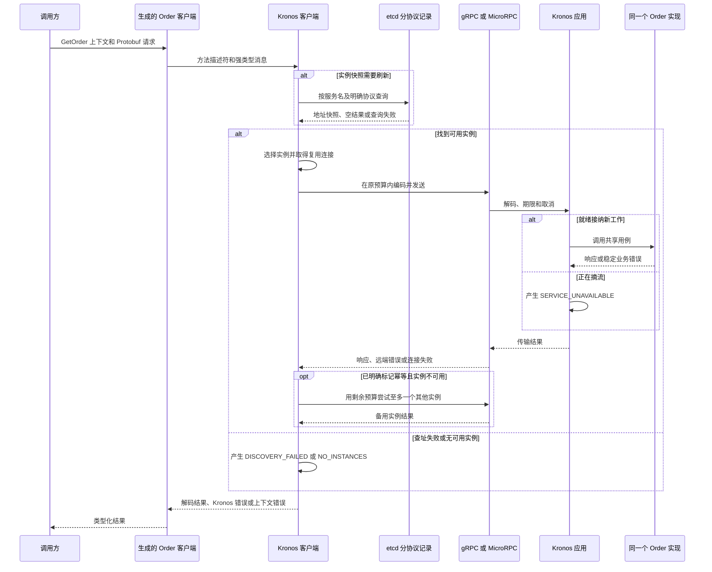
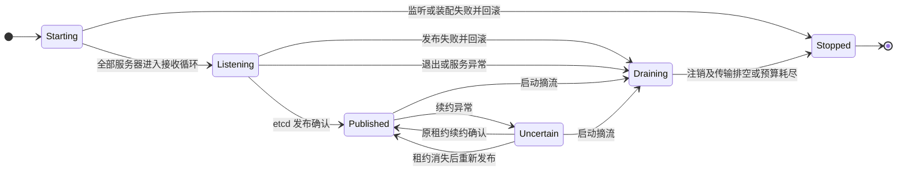

# 一元 RPC 系统边界

Order 的用户结果是按服务名取得预期订单，或在调用预算内取得可处理的失败。服务拥有 Protobuf 方法、消息、错误原因和幂等声明。调用入口拥有发现名、协议及上下文，启动入口拥有 etcd 实例和配置。Kronos 组合现有生命周期、传输和编解码，把两个独立端口接到同一业务实现。[统一一元服务装配](../design/unary-service-api.md) · [职责层与依赖](../adr/0004-layer-and-module-boundaries.md)

## 端到端调用链路

gRPC 的方法路径来自 Proto 全服务名和方法名。MicroRPC 使用明确的发现名以及 Proto 短服务名和方法名。官方旧客户端读取既有 etcd 前缀，通过 MicroRPC 接入同一用例。标准 gRPC 与旧协议客户端各读自己的端口记录，共同使用一次 etcd 发布事务的实例 ID 和租约。[注册记录](../adr/0009-discovery-protocols.md) · [官方双向互通](../../test/interop/microv2/etcd_test.go)

## 生命周期与可发现状态

| 状态 | 事实与观察位置 |
| --- | --- |
| Liveness 存活 | 由进程与部署层判断。在诊断监听服务期间可用 `/livez` 观察。发布失败或退出后以进程状态确认结束。 |
| Readiness 就绪 | `framework/app.Ready()` 表示监听已进入接收循环并接纳新工作。诊断监听提供 `/readyz`。发布启动前已经就绪，摘流开始时立即撤销。 |
| Discoverability 可发现 | 由调用方从 etcd 查询各协议地址确认。续约失败期间地址可能继续存留到 TTL。客户端的快照由自己的刷新时机决定。 |

进程崩溃可发生在任意运行态。存活和就绪随进程结束而消失。etcd 在租约过期后回收地址，之前的地址快照可能遭遇连接错误。应用不使用本地状态代替外部查询结果。[生命周期执行](../../framework/app/app.go) · [真实租约验证](../../infra/etcd/integration_test.go)

## 故障如何跨边界传播

| 故障与影响范围 | 观察结果 | 隔离与收尾 |
| --- | --- | --- |
| 端口无法绑定或首次 etcd 发布失败 | `Run` 返回启动错误，两个端口最终可重绑，协议地址无可发现记录 | 应用回滚本次监听和服务器。已创建但发布失败的租约由适配器尝试撤销。 |
| etcd 到实例或调用方的路径中断 | 续约或查址出现错误，同时已知地址仍可执行订单 | 单次 etcd 请求有 2 秒预算。共享查址只持有一个完成信号。每个调用方可独立取消。 |
| 旧地址仍在客户端快照 | 不可用错误或传输失败。已知摘流状态使用 `SERVICE_UNAVAILABLE` | 暂时跳过失败地址，下一次快照刷新移除失效端点。Proto 声明幂等的调用在原预算内至多尝试一个备用地址。 |
| 调用到期、显式取消或主动关闭客户端 | 返回对应上下文错误或客户端关闭错误。处理器收到取消。 | gRPC 传播期限，MicroRPC 通过纳秒级 `Timeout` 传播并保留 30 秒上限。地址退役后，最后一个使用方负责释放连接。 |
| 收到退出信号 | 失去就绪，地址撤销，旧连接上的新调用被拒绝。已接纳调用可继续。 | 摘除与排空共享关停预算。预算耗尽时由传输中止剩余调用，监听最终关闭。 |
| 实例被强制结束 | 业务调用失败，etcd 记录随后到期。 | 当前客户端持续按策略发现其他实例。让重启后的进程实际返回订单再确认恢复。 |

`framework/app` 管理启动和关停顺序。etcd 管理租约与协议地址。Kronos 客户端管理快照、连接与调用预算。协议绑定负责在传输和稳定业务错误之间转换。每个可重试动作都由拥有原始预算的组件执行。[发现与重试](../design/discovered-rpc-client.md) · [关停与取消](../../test/interop/microv2/drain_test.go)

## 运行反馈与风险审查

| 目标 | 观察与判定 | 有界处置与结果验收 |
| --- | --- | --- |
| 启动后可按名调用 | 检查两个实际端口、注册事件及客户端返回的业务结果 | 启动配置有误时恢复已验证配置并按原入口启动。核对协议发现和新订单请求。 |
| 注册中心恢复后重新接通 | 对照续约失败、租约丢失、重新发布和客户端发现错误的时间顺序 | 恢复连接后由 etcd 客户端按退避重连，续约按 5 秒节奏运行。用经过故障的客户端按服务名取得订单。 |
| 隔离单实例故障 | 用指标定位协议、方法和角色，再从失败日志关联 Trace。区分地址不可用、服务无实例和共享查址失败，核对传输尝试次数。 | 调用选择暂避不可用地址，按幂等契约控制重放。确认其他实例继续返回预期订单。 |
| 有界关停 | 观察 `/readyz`、摘流拒绝、在途指标、连接退出和端口释放 | 停止接纳后注销，按预算等已接纳调用结束。核对退出进程、端口和地址记录。 |

设计、变更和上线前都从协议、注册中心、网络、实例和资源五个边界选择会受影响的行。先采集只读证据，再按现有发布与回滚权限恢复依赖或已验证配置。复盘记录用户影响、时间线、触发条件、剩余不确定性和预防措施。将措施作为候选规则，附上故障反例与回归验证，由维护者审查后纳入工程约定。实际订单响应是恢复验收的停止条件。[Acuity](https://github.com/fangfengxiang/acuity/blob/main/SKILL.md) · [Google SRE 监测](https://sre.google/sre-book/monitoring-distributed-systems/) · [Google SRE 复盘](https://sre.google/sre-book/postmortem-culture/)

系统要求、接口、执行点和原生 Go 证据在[治理追踪表](../design/service-governance.md#需求追踪)中对应。
